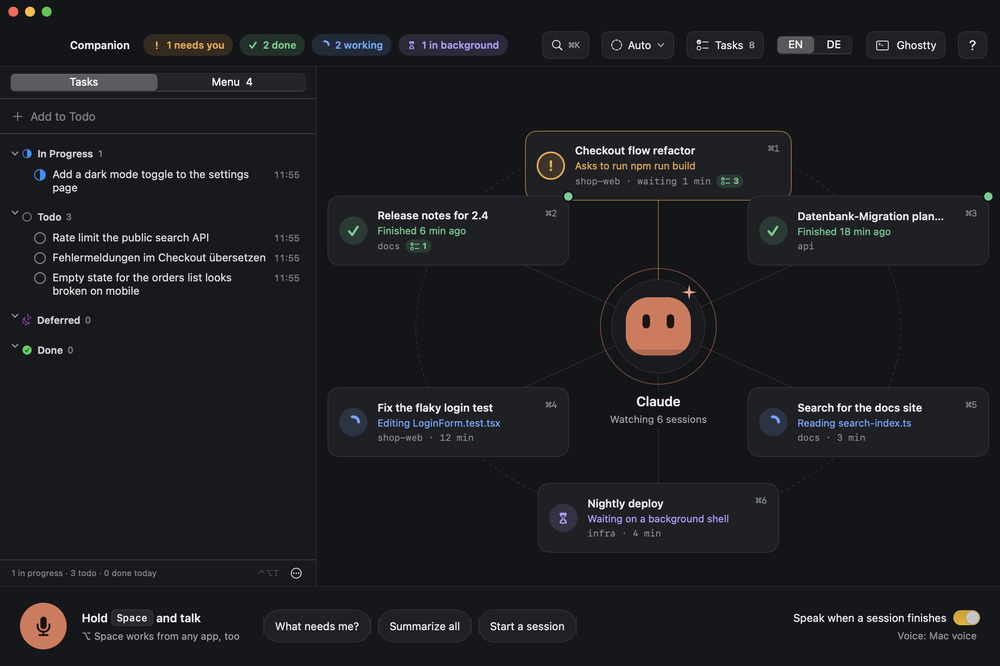
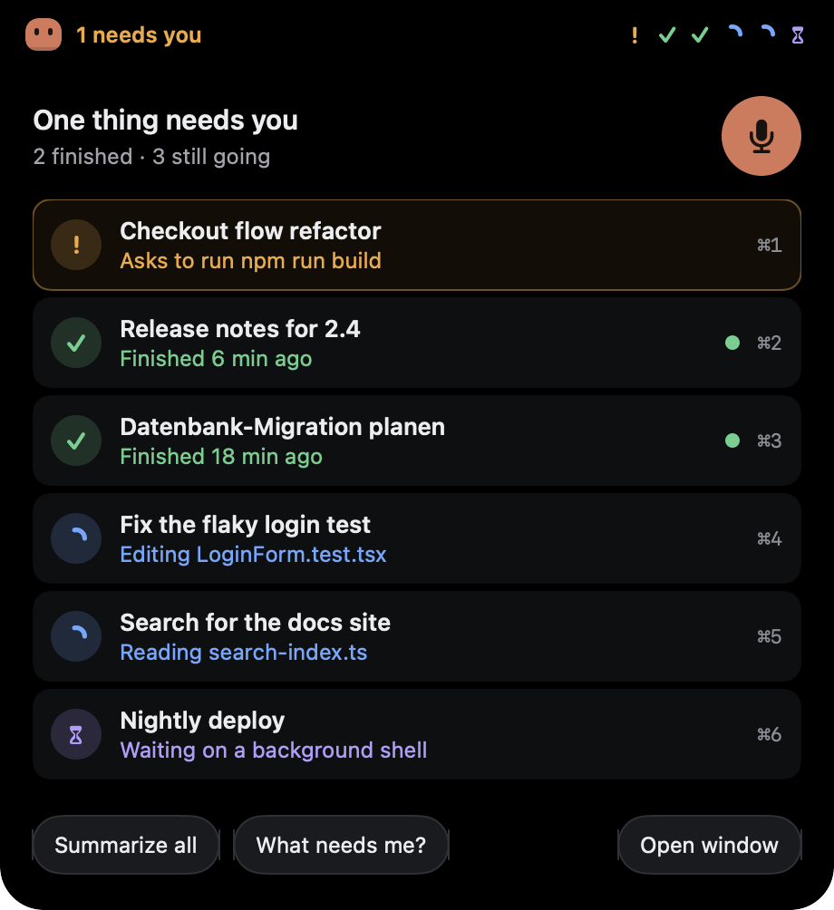
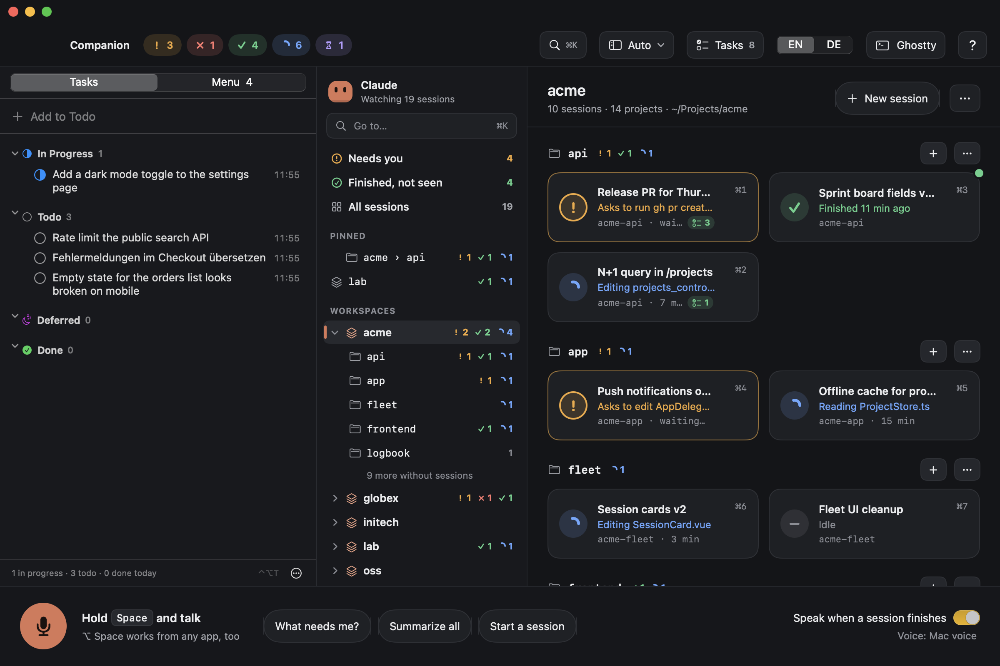
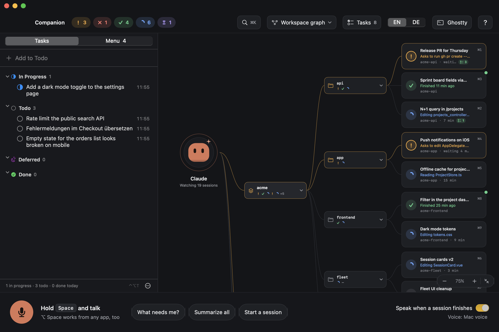
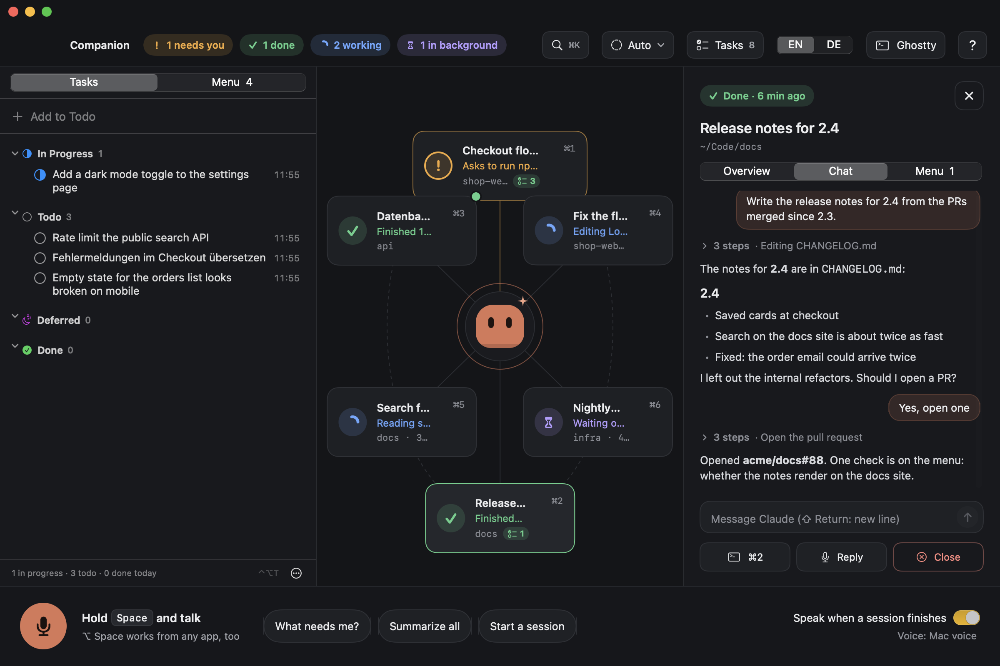

# Claude Companion

A companion for the Claude Code sessions you run in Ghostty. Every open session sits around a small avatar, and whatever needs you floats to the top. The companion says out loud when a session finishes or waits on you, and you can talk to it: hold Space, ask what needs you, have a session summarized, send one a prompt, or start a new one. Ghostty stays the terminal underneath.

It also has [Task Tracker](https://github.com/nfpocket/task-tracker) built in: your task list in the menu bar (⌃⌥T), and the menu of checks and ideas agents leave on their PRs, shown on the session that opened each PR.

<p>
  
  
</p>

## Install

Needs macOS 14, Swift 6, Ghostty 1.3 or later and Claude Code.

```sh
./scripts/build-app.sh --install
./scripts/install-hooks.sh
```

The first builds the app, copies it to `~/Applications` and starts it, and installs the `menu` command to `~/.local/bin`. Without `--install` it only builds `build/Claude Companion.app`. If the standalone Task Tracker app is running, it is quit: the companion has it built in and uses the same data. The second script lets the app see when a session is waiting on you (see [Setup](#setup)).

Voice needs an ElevenLabs API key in the login Keychain:

```sh
security add-generic-password -a "$USER" -s elevenlabs -w
```

Without it the companion speaks with the Mac voice and voice input is off. macOS asks for the microphone the first time you hold Space, for permission to control Ghostty the first time the companion talks to it, and for access to Documents (or Desktop) when your projects live there: the companion lists the other projects in each workspace folder. Without that access, workspaces still work, but projects there without a session aren’t listed. The build is signed with your Apple Development identity when you have one, so these answers survive rebuilds; with ad-hoc signing (no identity, or `CODESIGN_IDENTITY=-`) macOS asks again after each build.

## Keys

| Key | |
| --- | --- |
| Space (hold) | Talk, while the window is in front |
| ⌥ Space (hold) | Talk, from any app |
| Space or ⌥ Space (tap) | Stop the companion mid-sentence |
| Esc | Cancel a countdown, stop talking, close the detail |
| Return | Do the proposed action now |
| ⌘1 – ⌘9 | Open that Ghostty tab (in Ghostty's front window, when there are several) |
| ⌘K | Go to a session, project or workspace |
| ⌃⌘0 – ⌃⌘3 | Layout: automatic, orbit, workspace graph, sidebar |
| ⌘+, ⌘−, ⌥⌘0 | Zoom the graph in, out, or to fit the window |
| ⌘0 | Show the window |
| ⌃⌥T | Open or close the task list, from any app |

In the chat field: Return sends, ⇧ Return or ⌥ Return starts a new line, Esc leaves the field (what you typed stays).

In the task list: Return adds a task or renames the selected one, ⌘Return starts a new line, Space marks it done, ⌘1 – ⌘4 move it to In Progress, Todo, Deferred or Done, ⇧⌘N groups the selection into a folder, ⌫ deletes and ⌘Z undoes.

Click a session for where it stands, your last prompt, and buttons to open its tab, reply by voice, read it aloud, or stop it. Its **Chat** tab shows the conversation and lets you write to it without leaving the companion (see [Chat](#chat)). When the window isn't in front, the companion folds into the notch (or a pill under the menu bar on screens without one); click it for the list. When a session finishes or needs you, the notice drops out of the notch with **Open in Ghostty**: click it to jump to that tab. It shows up even when the companion is muted or "speak when a session finishes" is off.

## Many sessions, many projects

<p>
  
  
</p>

The window picks its layout by how much is going on, and only changes it while you're not looking (as the window comes to the front, never under your eyes):

| | |
| --- | --- |
| **Orbit** | Up to 6 sessions: each one around the avatar. |
| **Workspace graph** | 7 to 15 sessions in more than one place: Claude, then a node per workspace, its projects, and their sessions. |
| **Sidebar** | 16 sessions or more, or 10 projects or more: every workspace and project in a tree on the left, the one you pick on the right. |

The layout button in the header (or View in the menu bar, ⌃⌘0 – ⌃⌘3) pins one layout instead; **Automatic** goes back to choosing.

**Workspaces** are the folders your projects sit in, as in Finder: `~/Projects/acme/acme-api` is the project **api** in the workspace **acme** (the workspace's name is dropped from the front of its projects' names). Code folders on the way there, like Documents, Projects, Code or Developer, are passed through, and so is a folder that only holds workspaces. If that guesses wrong, **Workspaces come from › Choose a code folder…** in the layout menu makes every folder in it a workspace. A project is the git repo a session works in, so a worktree or a subfolder counts as its repo; a session started in a workspace's own folder shows as `acme/`. Projects without a session are listed too: the ones Claude Code ran in before, and the other git repos in each workspace.

- **The graph** is a canvas: scroll (or two fingers) to move around, pinch or ⌘-scroll to zoom, ⌘+ and ⌘− too, and the corner buttons fit everything in. It starts as big as fits, but never so small you can't read it. Click a workspace or project for its folder: Finder, a Ghostty tab, your editor (VS Code, Cursor, Zed, Sublime Text or Nova), a new session, pinning it. The chevron folds it; a folded workspace keeps the sessions that need you or failed beside it, and **Fold all the others** leaves one open.
- **The sidebar** starts with **Needs you**, **Finished, not seen** and **All sessions**, then what you pinned, then every workspace with its projects (and the ones without sessions, a click away). Pick a workspace for its sessions by project, a project for its own; the ones without sessions are chips to start a session in or open. Right-click a workspace to pin it, or hide it while nothing runs in it.
- **⌘K** finds any session, project or workspace by a few letters of each (“acme app”): Return opens the session's Ghostty tab or shows the project, ⌘Return shows the session here, and the last lines start a session in the project or open it in Ghostty.
- **The notch**, with more than eight sessions, lists what needs you first and then one line per workspace with how its sessions stand; click one for its sessions.

### Ghostty windows and tabs

New sessions (and shells opened from a project) go into the Ghostty window that mostly holds their workspace's sessions; when there is none yet, into a new window. Tabs that are already open stay where they are: Ghostty can't move a tab to another window.

Each session's tab is named after its project and title, like `✅ api · Release PR`. The icon in front is the one the tab had before (Claude Code's own, or ✅ ❌ ⏳ from a tab-status script), and ❗ while the session needs you; a tab without one gets an icon for its status. Tabs get their own titles back when the session ends, when the companion quits, or when you switch it off. **Sort the tabs by project** puts each window's tabs in order. All three are in the layout menu under Ghostty.

## Talking

| Say | |
| --- | --- |
| “What needs me?” | Reads out only the sessions waiting on you |
| “Summarize everything” | A short spoken briefing, most urgent first, with captions |
| “What did the Outlook one do?” | Where one session stands |
| “Tell the fleet cleanup to also check the settings page” | Types that into its tab and presses Return, after 3 s |
| “Open the dashboard one” | Brings its Ghostty tab to the front |
| “Start a session in claude-hub: build the settings screen” | A new Ghostty tab running `claude '<prompt>'`, after 3 s |
| “Stop the deploy one” | Presses Esc in its tab, after 2.5 s |
| “Close the Outlook session” | Types `/exit` and closes the tab, after you confirm |
| “Only tell me when something needs me”, “Be quiet for an hour”, “You can talk again” | Announcements |
| “What can I check?” | Reads out the open checks on the menu |
| “Sprich Deutsch”, “Speak English” | The language the companion speaks |

Sessions are matched loosely, and “number three” means the session in Ghostty tab 3. Follow-ups work: when the companion asks which session you mean, just say “the Outlook one”. Esc or “cancel” stops any countdown. English and German both work.

## Chat



The Chat tab of a session is a second view of the session running in Ghostty, not a session of its own. It shows the conversation from the session's transcript: your prompts, Claude's answers with their Markdown, and the tool calls in between folded into one line (click it for each step; failed ones are red). It follows along after each step while Claude works.

What you write there is typed into the session's Ghostty tab and sent with Return, as if you had typed it in the terminal, so slash commands work too. While Claude is busy, Claude Code queues the message and the chat shows it as waiting. Hooks, settings and permissions stay what they are, and you can switch to the terminal at any point.

Permission prompts, questions and plans are answered in Ghostty: when a session waits on you, the chat says what it's asking, and **Answer in Ghostty** opens its tab.

## Tasks

The ☑ in the menu bar (or ⌃⌥T) opens the task list: In Progress, Todo, Deferred and Done, with folders, links, images and reminders. The same list, with the Menu tab, sits on the left of the orbit window behind the Tasks button; drag its edge to make it wider. Right-click a task, a folder or a menu item:

- **Start a new session with it** opens `claude` in a new Ghostty tab in the folder you pick and puts the task into its prompt once it's ready.
- **Paste into a session** puts the task into an open session's prompt and brings its tab forward.

Nothing is sent: edit it in Ghostty, then press Return. Images attached to a task are added as file paths, so Claude can read them; a menu item brings where to check it, why, and its PR.

## The menu

While an agent builds something, the menu holds what you can do by hand in the meantime: the checks the agent couldn't verify itself, and the ideas it left out of scope, grouped by PR.

- **Agents fill it.** A Claude Code hook notices `gh pr create` and tells the agent to add its checks and ideas with `menu add`. It also remembers the session, so a session card shows a ☑ badge with what's open on its PRs, and its detail lists them.
- **You decide each item.** A check: **Works**, or **Problem…**, which becomes a comment on the PR while it's open and a new issue once it's merged. An idea: **Make issue**, **Later** or **Dismiss**. The Menu tab next to Tasks has every PR, with right-click to delete and ⌘Z to take back a change.
- **Fix in its session** sends the problems on a PR to the session that built it, in Ghostty: typed into its tab if it's still open, resumed in a new tab if not.

`menu help` lists every command. Add the hook to `~/.claude/settings.json`:

```json
"PostToolUse": [
  { "matcher": "Bash", "hooks": [{ "type": "command", "command": "~/.local/bin/menu hook", "timeout": 15 }] }
]
```

To put new issues on a project board, add the repo to `menu-config.json` next to the data file:

```json
{ "projects": { "owner/repo": {
  "owner": "owner", "number": 4, "projectId": "PVT_…", "statusField": "PVTSSF_…", "statusOption": "<Backlog option id>"
} } }
```

## Language

**EN | DE** in the header switches the interface. What the companion says has its own setting in the voice menu at the bottom right: match each session (German sessions get German summaries and announcements in a German voice), always English, or always German. Both voices can be picked there too.

Spoken audio is cached by text, so repeated announcements cost nothing. When fewer than 500 ElevenLabs characters are left, the companion switches to the Mac voice on its own.

## Setup

The companion reads what Claude Code already writes: `~/.claude/sessions/` for which sessions are alive and busy, and each session's transcript for its title, last prompt, last answer and current tool. A session's project comes from the `.git` folder (or worktree file) above its folder, read from disk without running git, and its workspace from the folders above that. Ghostty's AppleScript dictionary tells it which tab holds which session (by tty) and lets it focus tabs, type and open new ones. Summaries and understanding what you said are quick `claude -p` calls with Haiku, on your normal Claude login, without tools, hooks or MCP servers.

To see when a session waits on you (a permission prompt, a question, a plan), `./scripts/install-hooks.sh` adds async hooks to `~/.claude/settings.json` that run `~/.claude/hooks/companion-hook.sh`. It backs up the settings first and is safe to run again; `--remove` takes the hooks out. Sessions that are already running may need a restart to pick them up.

## Data

Tasks are saved to `~/Library/Application Support/TaskTracker/tasks.json`, images to the `attachments` folder next to it, the menu to `menu.json` (the same files the standalone Task Tracker used). Summaries are saved to `~/Library/Application Support/ClaudeCompanion/summaries.json`, spoken audio to `~/Library/Caches/ClaudeCompanion/tts`, hook events to `~/.claude/companion/events`, settings to `defaults read local.claude-companion`.

## Development

```sh
swift test
swift build
.build/debug/ClaudeCompanion --dump                              # what the app sees, without the UI
.build/debug/ClaudeCompanion --dump --route "what needs me" --summarize
.build/debug/ClaudeCompanion --chat <transcript.jsonl>           # what the Chat tab shows for a transcript
scripts/companion-say.sh "summarize everything"                  # act on text as if it were spoken
COMPANION_DEMO=screenshots .build/debug/ClaudeCompanion          # made-up sessions: writes the screenshots, then quits
COMPANION_DEMO=/tmp/shots COMPANION_DEMO_SET=large .build/debug/ClaudeCompanion   # 19 sessions in 6 workspaces: sidebar, graph, ⌘K, notch
```

`Sources/TaskTrackerCore`, `TaskTrackerUI` and `MenuCLI` are Task Tracker, moved in from its repo; `TASKTRACKER_DATA=/tmp/tasks.json` points them at a test list.
